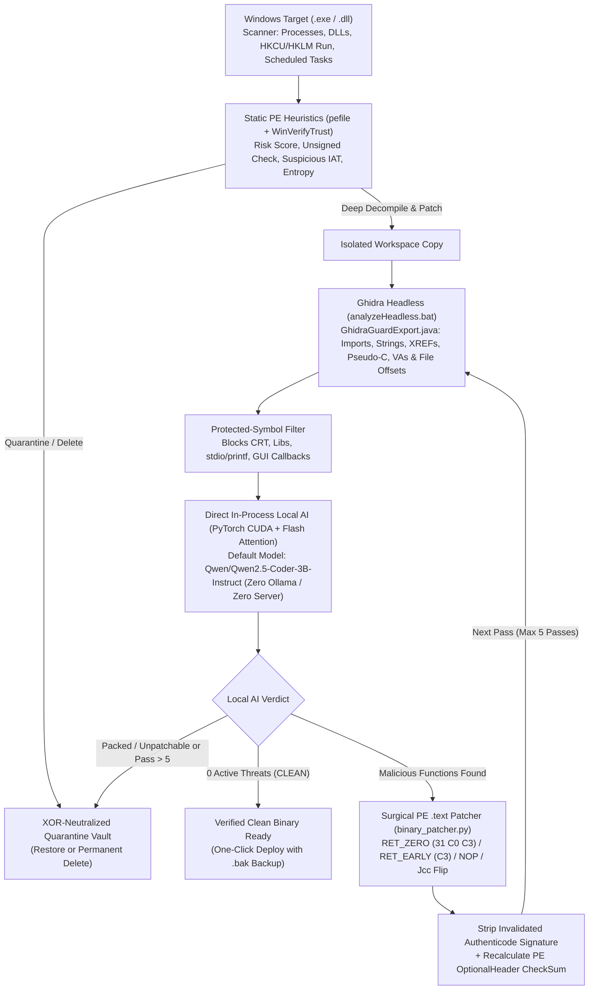
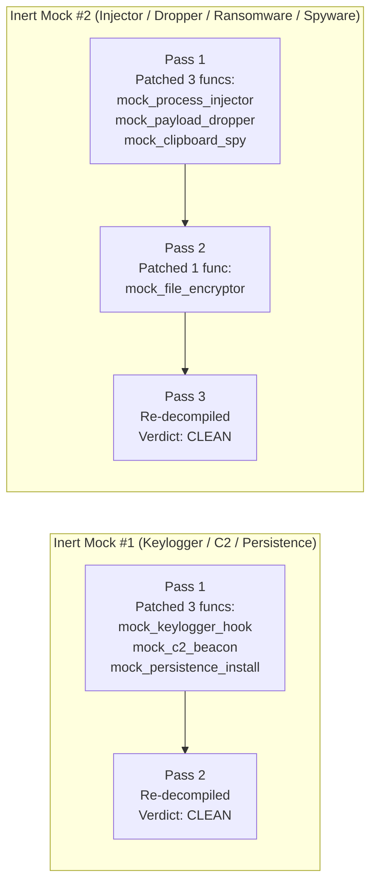

# GhidraGuard (`v0.2.0-beta.1` — CUDA + Flash Attention & Android Edition)

> **Built on November 21–22, 2026 using Gemini 4 Neon.**
>
> **Status:** Early Beta (`v0.2.0-beta.1`). Intended for local reverse engineering research, malware triage, and defensive binary-patching experiments. Always test on isolated copies and review diffs before deploying patched binaries.

**GhidraGuard** is a **100% free, local, offline** security, reverse-engineering, and AI-assisted binary-patching suite — available for **Windows Desktop** (Python `CustomTkinter` + Ghidra Headless + CUDA & Flash Attention) and **Android** (native Kotlin + Jetpack Compose in [`android/`](android/)).

- **Zero Ollama / Zero External Server / Zero Cloud:** Directly loads and runs local AI models **in-process** — PyTorch CUDA + Flash Attention on Windows Desktop, and Google MediaPipe `LlmInference` (Mobile GPU / CPU, zero `INTERNET` permission) on Android.
- **Direct CUDA & Flash Attention Engine (`cuda_engine.py`):**
  - Auto-detects NVIDIA CUDA GPUs (VRAM, CUDA version, compute capability, `bf16`, `flash_attn` FlashAttention-2, and PyTorch native CUDA SDPA Flash Attention).
  - Loads local HuggingFace models (default `Qwen/Qwen2.5-Coder-3B-Instruct` or any local model folder) directly into VRAM using `flash_attention_2` or PyTorch `SDPBackend.FLASH_ATTENTION` in `bf16`/`fp16`/`4bit-nf4` (with automatic CPU fallback).
- **Android Version (`android/`):** 100% offline native Kotlin + Jetpack Compose app (`com.flaxyditto.ghidraguard`, **zero `INTERNET` permission**) with direct on-device MediaPipe LLM inference (`.task` / `.litertlm` / `.bin` on Mobile GPU or CPU), built-in static analyzer fallback, installed app & APK/DEX/ELF **+ Windows PE (`.exe`/`.dll`)** heuristic scanning, surgical ARM64/ARMv7/x86_64 ELF & x86/x64 Windows PE `.text` patching (with Authenticode stripping & PE checksum recalculation), XOR-neutralized Quarantine Vault, and network & device posture monitor.
- **Ghidra Headless Integration:** Automatically discovers `analyzeHeadless.bat` up to two directory levels deep under `C:\*` (`C:\<folder>\<subfolder>\support\analyzeHeadless.bat`) with manual path override.
- **Surgical Safety Guardrails:** Hard-blocks patches targeting entrypoints (`main`/`WinMain`/`DllMain`), CRT/standard libraries (`__mingw_*`, `malloc`, `memcpy`), print/logging helpers (`printf`, `puts`), and GUI window message loops (`WndProc`, `DefWindowProc`, `BeginPaint`).

---

## How GhidraGuard Works (Architecture & Pipeline Visualization)



---

## Benchmark & Mock Performance Visualization

To validate the full pipeline end-to-end without publishing any malware or mock binaries, GhidraGuard was tested locally against two **100% inert, harmless simulation PE binaries** (compiled with `-O0`, where all Win32 API calls were guarded behind a `volatile int g_inert_flag = 0` so nothing ever executed against the OS). The mock source and binaries are intentionally excluded from this repository.

### Multi-Pass Convergence Overview (`Ghidra 12.1.4` + `Ollama qwen2.5-coder:3b`)



### Detailed Patch & Runtime Verification Results

#### Test Fixture #1 (Keylogger, C2 Beacon, Registry Persistence + Benign Calculator)
- **Passes to `CLEAN`:** 2 passes
- **Surgical `.text` Patches Applied:**

| Pass | Function | PE File Offset | Before Bytes | After Bytes | Strategy |
| --- | --- | --- | --- | --- | --- |
| 1 | `mock_keylogger_hook` | `0xaf4` | `55 48 89` | `31 C0 C3` | `RET_ZERO` (`xor eax, eax; ret`) |
| 1 | `mock_c2_beacon` | `0xb6a` | `55 48 89` | `31 C0 C3` | `RET_ZERO` (`xor eax, eax; ret`) |
| 1 | `mock_persistence_install` | `0xbf3` | `55 48 89` | `31 C0 C3` | `RET_ZERO` (`xor eax, eax; ret`) |

- **Runtime Result After Patching:** `mock_keylogger_hook`, `mock_c2_beacon`, and `mock_persistence_install` all returned **`NEUTRALIZED (ret=0)`**, while `benign_calculator(19, 23)` remained untouched and returned **`42`**.

#### Test Fixture #2 (Process Injector, Payload Dropper, Ransomware Crypto, Clipboard Spy + Benign Health Check)
- **Passes to `CLEAN`:** 3 passes (**4/4** simulated threats neutralized)
- **Surgical `.text` Patches Applied:**

| Pass | Function | PE File Offset | Before Bytes | After Bytes | Strategy |
| --- | --- | --- | --- | --- | --- |
| 1 | `mock_process_injector` | `0xab4` | `55 48 89` | `31 C0 C3` | `RET_ZERO` (`xor eax, eax; ret`) |
| 1 | `mock_payload_dropper` | `0xbc2` | `55 48 89` | `31 C0 C3` | `RET_ZERO` (`xor eax, eax; ret`) |
| 1 | `mock_clipboard_spy` | `0xd35` | `55 48 89` | `31 C0 C3` | `RET_ZERO` (`xor eax, eax; ret`) |
| 2 | `mock_file_encryptor` | `0xc55` | `55 48 89` | `31 C0 C3` | `RET_ZERO` (`xor eax, eax; ret`) |

- **Runtime Result After Patching:**
```text
--- Verification Summary ---
  mock_process_injector  : NEUTRALIZED (ret=0)
  mock_payload_dropper   : NEUTRALIZED (ret=0)
  mock_file_encryptor    : NEUTRALIZED (ret=0)
  mock_clipboard_spy     : NEUTRALIZED (ret=0)
  benign_health_check()  : 777 (expected 777)
```

---

## Project Modules

| Module | Description |
| --- | --- |
| `main.py` | Dark-mode glassmorphic `CustomTkinter` desktop UI: Threat Scanner, AI Decompile & Patch Lab (pass-by-pass viewer + hex diff summary), Live Network Monitor, System Repair (`sfc /scannow`, `DISM`), Quarantine Vault, Settings, and Real-Time Terminal Log. |
| `scanner.py` | Scans running processes, loaded user-space DLLs, `HKCU`/`HKLM` `Run`/`RunOnce` keys, Scheduled Tasks, and active TCP/UDP connections (`psutil`, `winreg`, `pefile`, Win32 `WinVerifyTrust`). |
| `ghidra_engine.py` | Auto-discovers `analyzeHeadless.bat` on `C:\*`, copies targets into an isolated workspace, runs the embedded `GhidraGuardExport.java` post-script with protected-symbol filtering, and verifies PE file offsets with `pefile`. |
| `ai_auditor.py` | Direct in-process `DirectLocalAIClient` (zero Ollama / zero HTTP server) with CUDA GPU offload, Flash Attention 32K+ context scaling, strict JSON patch parsing, CRT/print/GUI safety guardrails, and max-5-pass iterative re-verification loop. |
| `cuda_engine.py` | NVIDIA CUDA & Flash Attention hardware detector, direct PyTorch `flash_attention_2` / SDPA Flash Attention inference engine (`bf16`/`fp16`/`4bit-nf4` + CPU fallback), local HF cache discovery, and CUDA micro-benchmark self-test. |
| `auto_setup.py` | One-click automatic bootstrapper (CLI + GUI): checks and auto-downloads portable Eclipse Temurin JDK 21+, official NSA Ghidra ZIP, and PyTorch CUDA + Transformers stack if missing. |
| `binary_patcher.py` | Applies verified byte patches strictly inside executable PE sections, strips invalidated Authenticode signatures, recalculates PE `CheckSum`, and manages backups + XOR-neutralized Quarantine Vault. |
| `android/` | 100% offline native Android version (Kotlin + Jetpack Compose, minSdk 26 / targetSdk 36, **zero `INTERNET` permission**): direct on-device MediaPipe `LlmInference` (Mobile GPU / CPU for `.task`/`.litertlm`/`.bin` models), built-in static analyzer fallback, installed app & APK/DEX/ELF scanner, surgical ARM64/ARMv7/x86_64 ELF `.text` patcher, XOR-neutralized Quarantine Vault, and network & device posture monitor. |

---

## Quick Start & Building

### Prerequisites (Windows Desktop)
1. **Windows 10/11 (64-bit)** with Python 3.11–3.13 (and an NVIDIA CUDA GPU for Flash Attention acceleration, or CPU fallback).
2. **Ghidra** extracted under `C:\` (up to 2 levels deep, e.g., `C:\Ghidra\ghidra_12.1.4\support\analyzeHeadless.bat`).
3. **No Ollama or external LLM server required** — GhidraGuard loads local HuggingFace models (`Qwen/Qwen2.5-Coder-3B-Instruct` or any local model folder) directly in-process via PyTorch CUDA + Flash Attention.

### Run from Source (Windows)
```powershell
pip install -r requirements.txt
# Install PyTorch CUDA + Transformers for direct in-process CUDA + Flash Attention inference:
pip install --index-url https://download.pytorch.org/whl/cu128 torch
pip install -r requirements-cuda.txt
python main.py
```

### Build Android Edition (`android/`)
```powershell
cd android
.\gradlew.bat assembleDebug
```
Outputs `android\app\build\outputs\apk\debug\app-debug.apk` (bundles the native MediaPipe on-device LLM runtime with zero `INTERNET` permission).

### Compile Standalone Elevated `.exe`
```bat
build.bat
```
Compiles `dist\GhidraGuard.exe` via `PyInstaller --noconsole --onefile --uac-admin --name "GhidraGuard" --collect-all customtkinter --clean main.py`.
