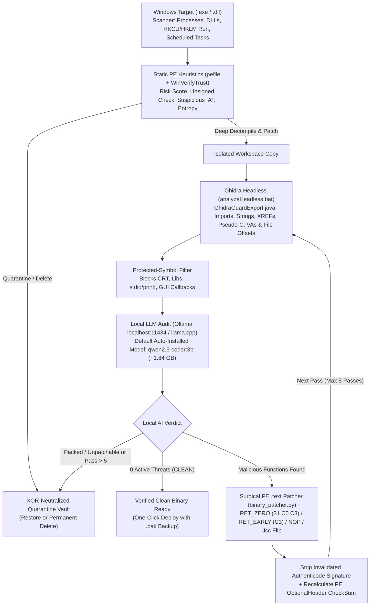
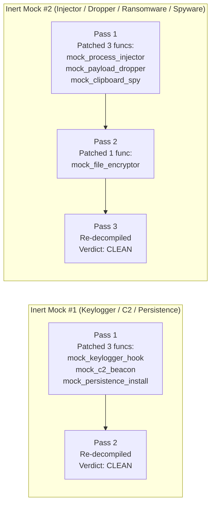

# GhidraGuard (`v0.1.0-beta.1` — Extremely Early Beta)

> **Built on November 21, 2026 using Gemini 4 Neon.**
>
> **Status:** Extremely Early Beta (`v0.1.0-beta.1`). Intended for local reverse engineering research, malware triage, and defensive binary-patching experiments. Always test on isolated copies and review diffs before deploying patched binaries.

**GhidraGuard** is a **100% free, local, offline** Windows desktop security, reverse-engineering, and AI-assisted binary-patching application written in Python (`CustomTkinter`) and packaged into a standalone Administrator-elevated Windows executable (`GhidraGuard.exe`) via `PyInstaller`.

- **Zero Cloud / Zero Cost:** Strictly enforces localhost-only LLM endpoints (`http://localhost:11434` for Ollama or an OpenAI-compatible local `llama.cpp` server).
- **Auto-Installs a Compact Local Model (< 4 GB):** Automatically pulls `qwen2.5-coder:3b` (~1.84 GB Q4, runs smoothly even on CPU-only PCs) if local Ollama has no models installed.
- **Ghidra Headless Integration:** Automatically discovers `analyzeHeadless.bat` up to two directory levels deep under `C:\*` (`C:\<folder>\<subfolder>\support\analyzeHeadless.bat`) with manual path override.
- **Surgical Safety Guardrails:** Hard-blocks patches targeting entrypoints (`main`/`WinMain`/`DllMain`), CRT/standard libraries (`__mingw_*`, `malloc`, `memcpy`), print/logging helpers (`printf`, `puts`), and GUI window message loops (`WndProc`, `DefWindowProc`, `BeginPaint`).

---

## How GhidraGuard Works (Architecture & Pipeline Visualization)



---

## Benchmark & Mock Performance Visualization

To validate the full pipeline end-to-end without publishing any malware or mock binaries, GhidraGuard was tested locally against two **100% inert, harmless simulation PE binaries** (compiled with `-O0`, where all Win32 API calls were guarded behind a `volatile int g_inert_flag = 0` so nothing ever executed against the OS). The mock source and binaries are intentionally excluded from this repository.

### Multi-Pass Convergence Overview (`Ghidra 12.1.4` + `Ollama qwen2.5-coder:3b`)



### Detailed Patch & Runtime Verification Results

#### Test Fixture #1 (Keylogger, C2 Beacon, Registry Persistence + Benign Calculator)
- **Passes to `CLEAN`:** 2 passes
- **Surgical `.text` Patches Applied:**

| Pass | Function | PE File Offset | Before Bytes | After Bytes | Strategy |
| --- | --- | --- | --- | --- | --- |
| 1 | `mock_keylogger_hook` | `0xaf4` | `55 48 89` | `31 C0 C3` | `RET_ZERO` (`xor eax, eax; ret`) |
| 1 | `mock_c2_beacon` | `0xb6a` | `55 48 89` | `31 C0 C3` | `RET_ZERO` (`xor eax, eax; ret`) |
| 1 | `mock_persistence_install` | `0xbf3` | `55 48 89` | `31 C0 C3` | `RET_ZERO` (`xor eax, eax; ret`) |

- **Runtime Result After Patching:** `mock_keylogger_hook`, `mock_c2_beacon`, and `mock_persistence_install` all returned **`NEUTRALIZED (ret=0)`**, while `benign_calculator(19, 23)` remained untouched and returned **`42`**.

#### Test Fixture #2 (Process Injector, Payload Dropper, Ransomware Crypto, Clipboard Spy + Benign Health Check)
- **Passes to `CLEAN`:** 3 passes (**4/4** simulated threats neutralized)
- **Surgical `.text` Patches Applied:**

| Pass | Function | PE File Offset | Before Bytes | After Bytes | Strategy |
| --- | --- | --- | --- | --- | --- |
| 1 | `mock_process_injector` | `0xab4` | `55 48 89` | `31 C0 C3` | `RET_ZERO` (`xor eax, eax; ret`) |
| 1 | `mock_payload_dropper` | `0xbc2` | `55 48 89` | `31 C0 C3` | `RET_ZERO` (`xor eax, eax; ret`) |
| 1 | `mock_clipboard_spy` | `0xd35` | `55 48 89` | `31 C0 C3` | `RET_ZERO` (`xor eax, eax; ret`) |
| 2 | `mock_file_encryptor` | `0xc55` | `55 48 89` | `31 C0 C3` | `RET_ZERO` (`xor eax, eax; ret`) |

- **Runtime Result After Patching:**
```text
--- Verification Summary ---
  mock_process_injector  : NEUTRALIZED (ret=0)
  mock_payload_dropper   : NEUTRALIZED (ret=0)
  mock_file_encryptor    : NEUTRALIZED (ret=0)
  mock_clipboard_spy     : NEUTRALIZED (ret=0)
  benign_health_check()  : 777 (expected 777)
```

---

## Project Modules

| Module | Description |
| --- | --- |
| `main.py` | Dark-mode glassmorphic `CustomTkinter` desktop UI: Threat Scanner, AI Decompile & Patch Lab (pass-by-pass viewer + hex diff summary), Live Network Monitor, System Repair (`sfc /scannow`, `DISM`), Quarantine Vault, Settings, and Real-Time Terminal Log. |
| `scanner.py` | Scans running processes, loaded user-space DLLs, `HKCU`/`HKLM` `Run`/`RunOnce` keys, Scheduled Tasks, and active TCP/UDP connections (`psutil`, `winreg`, `pefile`, Win32 `WinVerifyTrust`). |
| `ghidra_engine.py` | Auto-discovers `analyzeHeadless.bat` on `C:\*`, copies targets into an isolated workspace, runs the embedded `GhidraGuardExport.java` post-script with protected-symbol filtering, and verifies PE file offsets with `pefile`. |
| `ai_auditor.py` | Localhost-only Ollama / `llama.cpp` client with automatic `qwen2.5-coder:3b` installation, strict JSON patch parsing, CRT/print/GUI safety guardrails, and max-5-pass iterative re-verification loop. |
| `binary_patcher.py` | Applies verified byte patches strictly inside executable PE sections, strips invalidated Authenticode signatures, recalculates PE `CheckSum`, and manages backups + XOR-neutralized Quarantine Vault. |

---

## Quick Start & Building `GhidraGuard.exe`

### Prerequisites
1. **Windows 10/11 (64-bit)** with Python 3.11–3.13.
2. **Ghidra** extracted under `C:\` (up to 2 levels deep, e.g., `C:\Ghidra\ghidra_12.1.4\support\analyzeHeadless.bat`).
3. **Ollama** running locally at `http://localhost:11434` (GhidraGuard automatically pulls `qwen2.5-coder:3b` if no models are installed) **or** a local `llama.cpp` server.

### Run from Source
```powershell
pip install -r requirements.txt
python main.py
```

### Compile Standalone Elevated `.exe`
```bat
build.bat
```
Compiles `dist\GhidraGuard.exe` via `PyInstaller --noconsole --onefile --uac-admin --name "GhidraGuard" --collect-all customtkinter --clean main.py`.
